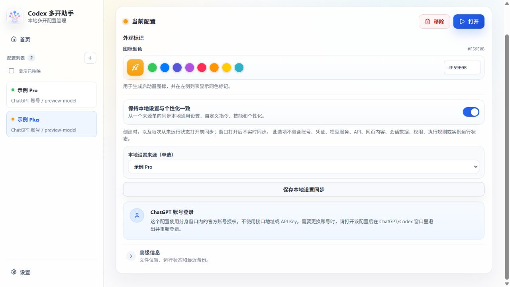

# 本地修改：设置与个性化同步

本功能基于上游 v0.1.9，增加「保持本地设置与个性化一致」开关。新配置和旧配置默认关闭；开启后指定一个来源，按下述范围向目标配置单向复制。各配置保留独立的登录与运行目录。

## 使用

1. 新建向导的第一步，或已有配置的设置页，开启「保持本地设置与个性化一致」。
2. 选择「当前 Codex / ChatGPT」（本机原应用的 Codex home）或一个已有的有效配置作为来源，不能选择自身。
3. 已有 ChatGPT 账号配置点击「保存本地设置同步」；API 配置与下方模型服务配置一起保存。
4. 创建时同步一次；以后通过多开助手「打开」目标配置时，先确认目标完全退出，再同步、启动。Windows 可在目标窗口使用 Ctrl+Q；只关闭显示窗口后若进程仍在，同步会被阻止。

例如让 Plus 跟随 Pro：在 Plus 配置中选 Pro 为来源。Pro 是设置的维护来源；Plus 中修改的同名设置、指令或技能文件会在下一次启动同步时被来源覆盖。不要将两个配置互相设为来源。

保存开关不会立即执行来源到目标的设置同步；关闭开关保留上次选定来源，不会自动撤销已同步的内容。窗口打开后不实时同步。管理器生成的桌面启动器会回到管理器启动入口，因此同样执行启动前同步。

启用此选项时，上游「沿用当前 Codex 设置」的一次性完整继承停用，避免把服务商、权限等配置混入本次同步。历史对话仍由上游的独立选项控制。



## 同步范围

| 范围 | 行为 |
| --- | --- |
| 通用外观与交互 | 合并已识别的主题、字体、语言、队列模式、终端位置、通知及部分编辑器偏好 |
| 个性化 | 合并已识别的 personality 与记忆功能开关；不复制记忆正文 |
| 自定义指令 | 复制 Codex home 中的 `AGENTS.md`、`instructions.md` |
| 技能与提示词 | 复制 `skills/`、`prompts/` 中的普通资源文件；排除已知凭证、执行规则、数据库、缓存及链接路径 |
| 账号、认证 | 不读取或复制登录 `auth.json`、Cookie、账号标识及其他已知凭证文件 |
| 服务与权限 | 不同步模型、API、服务商、端点、MCP、信任、沙箱、审批及执行规则 |
| 聊天与运行数据 | 不同步网页聊天、本地聊天、SQLite、项目/会话归属、窗口运行状态及设备配对 |

实现按明确的字段名单合并 `config.toml` 与 `.codex-global-state.json`，不整体覆盖这些文件。当前只覆盖上表中的已识别设置；未识别字段保持目标原值，不能保证未来应用新增的所有偏好自动纳入。字段名单见 `src/main/local-settings-sync.ts`。

来源不存在的字段或文件不会删除目标内容；同名指令、技能资源文件由来源完整覆盖。没有语义变化时不改写配置、不产生空备份。符号链接、目录联接、Windows 重解析点、硬链接和来源/目标路径重叠会被拒绝。

## 自动备份与恢复

只有需要更改目标文件时才创建备份。备份位于目标 Codex home 的同级 `backups/local-settings-sync-时间-编号/`，内有 `manifest.json`、`before/`、`after/`。全部备份完成后才写入目标；写入出错会尝试自动恢复并报告备份路径。Windows 备份目录限制为当前所有者访问。

已有配置页的「高级信息」可查看配置 ID 和文件路径；启动日志包含本次同步的备份目录。恢复前先关闭同步开关并完全退出目标配置，否则下一次启动仍会再次同步来源。

在仓库目录运行，替换示例占位值：

```powershell
Set-Location '<仓库目录>'
# 只显示恢复目标和备份信息
npm run restore:local-settings -- '<配置ID>' '<备份目录>'
# 确认目标完全退出后执行恢复
npm run restore:local-settings -- '<配置ID>' '<备份目录>' --execute
```

恢复按文件比对本次同步的写入结果。若之后有新的修改，该文件会保留并报告在 `conflicts` 中；旧内容仍留在 `before/`，供人工合并。恢复不会强制覆盖后续修改。

## 源码恢复与本地检查

原版提交：`23b76a1546f9e61fb75cc5f053dd22cafa14fd65`（v0.1.9）。源码通过 Git 提交和分支恢复；可以在新目录检出原版提交比较，避免覆盖正在修改的工作区。账号数据和运行时备份不进入 Git。

```powershell
npm run build
npm run verify:local-settings
```

界面模拟预览：运行 `npm run preview:local-settings`，打开 `http://127.0.0.1:5175/scripts/local-settings-preview.html`。示例数据和保存操作仅在网页内存中，关闭网页即丢弃，不连接真实账号或管理器数据库。

当前已完成源码构建、临时目录功能检查和模拟界面操作检查。尚未安装或接入用户实际 Pro、Plus 配置；本次修改未验证历史会话在两个账号间的执行归属，不能据此宣称该问题已解决。
